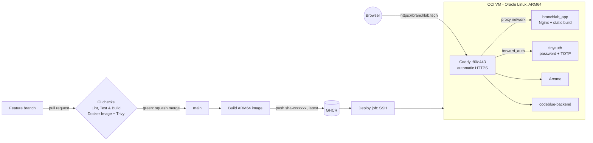

# 🌿 BranchLab — GitFlow & CI/CD Pipeline Simulator

[](https://github.com/Petya122/branchlab/actions/workflows/ci.yml)
[](https://branchlab.tech)
[](https://www.typescriptlang.org/)
[](https://vitest.dev/)

> **University DevOps School Project**  
> **Course:** DevOps és tesztelés (5. Félév) — Soproni Egyetem  
> **Repository:** [https://github.com/Petya122/branchlab](https://github.com/Petya122/branchlab)  
> **Production Target:** [https://branchlab.tech](https://branchlab.tech)

---

## 📖 Overview

**BranchLab** is an interactive web-based simulator designed to teach and demonstrate modern DevOps branching workflows and automated release pipelines. It models:

1. **Git Branching Strategies:**
   - **GitFlow** (`main`, `develop`, `feature/*`, `release/*`, `hotfix/*`)
   - **Trunk-Based Development** (single source trunk with short-lived feature branches)
   - **GitHub Flow** (lightweight PR-to-main strategy)
2. **CI/CD Pipeline Simulation:**
   - Visual execution of Lint, Vitest Unit Tests, SAST Security Audit, Vite Build, and Cloud Deployment (`branchlab.tech`).
   - Real-time terminal log outputs and exit code status.
   - **Chaos Mode / Error Injection:** Simulate broken unit tests or lint errors to demonstrate branch protection gates.
3. **Interactive DevOps Challenges:**
   - Emergency production hotfix scenarios.
   - Defending CI quality gates.
   - Feature release workflows.

---

## 🛠️ Technology Stack

- **Frontend:** React 19 + Vite (TypeScript)
- **Styling:** Custom Vanilla CSS design system with CSS variables, obsidian dark mode, glowing branch rails, and glassmorphic cards.
- **Testing:** Vitest + React Testing Library + `@testing-library/jest-dom`
- **Icons & Effects:** `lucide-react`, `canvas-confetti`
- **CI/CD Automation:** GitHub Actions (`.github/workflows/ci.yml`)
- **Container Registry:** GitHub Container Registry (`ghcr.io/petya122/branchlab`)
- **Hosting & DNS:** Oracle Cloud Infrastructure (OCI) Linux VM (Ampere ARM64): Caddy (automatic HTTPS) in front of an Nginx container on `branchlab.tech`

---

## 🚀 Quick Start

### 1. Installation

```bash
npm install
```

### 2. Run Local Development Server

```bash
npm run dev
```

Open `http://localhost:5173` to explore the interactive dashboard.

### 3. Run Automated Tests

```bash
npm run test:run        # unit + integration tests (Vitest, jsdom)
npm run test:coverage   # same, with a coverage report in coverage/index.html
npm run test:e2e        # browser tests (Playwright); first time: npx playwright install chromium
```

### 4. Typecheck & Production Build

```bash
npm run typecheck
npm run build
```

### 5. Run with Docker & Docker Compose

```bash
# One-time: the shared network that Caddy and the apps use
docker network create proxy

# Build and run the app container locally (served on the proxy network)
docker compose up -d --build

# View container logs
docker compose logs -f
```

The production reverse proxy (Caddy) and the server's other services live in
[`infra/`](infra/README.md).

---

## 🧪 DevOps & Testing Architecture

| Test Level          | Tool                           | Scope                                                                      |
| :------------------ | :----------------------------- | :------------------------------------------------------------------------- |
| **Type Integrity**  | `tsc -b`                       | Zero any, strict null checks, typed Git DAG and pipeline state machines    |
| **Unit Tests**      | `vitest`                       | Git/pipeline engines, terminal command parser, hooks (`useGitSimulator`, `usePipelineSimulator`, `useTrophies`, …) |
| **Integration Tests** | `@testing-library/react`     | The whole lab through the UI: terminal commands, git actions, pipeline + chaos, trophies, modals, StrictMode regression |
| **Coverage**        | `@vitest/coverage-v8`          | ~93% lines; CI fails below the thresholds in `vite.config.ts`, report shown in the job summary |
| **E2E Tests**       | **Playwright** (Chromium, desktop + mobile) | Real browser against the production Docker image: strict CSP (deny-by-default, no `unsafe-inline`) with zero violations, no third-party requests, lab flows, security headers |
| **Lint**            | `oxlint`                       | React hooks rules and TypeScript lint, warnings fail the build             |
| **Security**        | `npm audit` + **Trivy**        | Vulnerable npm dependencies and image (OS + library) CVEs                  |
| **CI Automation**   | **GitHub Actions**             | Automated validation on every `push` and `pull_request` to `main`          |
| **Deployment**      | **GHCR + OCI + Caddy**         | Versioned ARM64 image, health-checked deploy, smoke test on `branchlab.tech` |

---

## 🏗️ Architecture & Delivery Pipeline



### Branch workflow

`main` is protected by a GitHub ruleset: no direct pushes, no force pushes, and every change
arrives through a pull request whose **Lint, Test & Build** and **Docker Image** checks are green.

```bash
git switch -c feat/my-change
# ...commit using Conventional Commits (feat:, fix:, chore:, ci:)...
git push -u origin feat/my-change
# open a PR, wait for green checks, squash-merge -> automatic deploy
```

### Deploy, verify, roll back

| Step | What happens |
| :--- | :--- |
| Merge to `main` | CI builds the image on a native ARM64 runner, scans it with Trivy and pushes it to GHCR as `sha-<short>` and `latest` |
| Deploy | The server checks out `main`, pulls exactly that image and waits until the container is **healthy** (`docker compose up --wait`), then reloads Caddy |
| Smoke test | CI fetches `https://branchlab.tech/version.json` and checks that the live commit equals the merged one |
| Release | Push a tag `vX.Y.Z` to publish the image as `X.Y.Z`. Update [`CHANGELOG.md`](CHANGELOG.md) first |
| Roll back | **Actions → Rollback / Redeploy → Run workflow** with a tag like `sha-1a2b3c4` or `1.0.0` |
